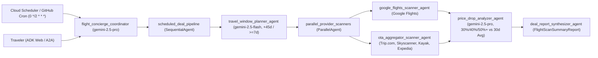

# Flight Deal Scanner Agent (Google ADK)

An enterprise-grade, multi-agent airfare scanner built on the **Google Agent Development Kit (ADK)** that monitors round-trip fares **every 2 hours, every day (`0 */2 * * *`)** from **SNA (John Wayne / Orange County)** and **LAX (Los Angeles)** to **Japan, London, Vancouver, Toronto, Spain, and Italy** (~45 days from today, minimum 7-day stay) across **Google Flights, Trip.com, Skyscanner, Kayak, and Expedia**, alerting you whenever prices drop by **30%, 40%, or 50%+** below the 30-day rolling average.

## Key Capabilities

* **Multi-Agent ADK Topology (`SequentialAgent` + `ParallelAgent` + Coordinator)**:
  * `travel_window_planner_agent` (`gemini-2.5-flash`) computes exact ISO-8601 travel dates ~45 days out with >= 7-day stay duration.
  * `parallel_provider_scanners` (`ParallelAgent`) runs `google_flights_scanner_agent` and `ota_aggregator_scanner_agent` (**Trip.com, Skyscanner, Kayak, Expedia**) concurrently with `include_contents="none"` context isolation.
  * `price_drop_analyzer_agent` (`gemini-2.5-pro`) evaluates quotes against persistent 30-day rolling route baselines (`DROP_30_PERCENT`, `DROP_40_PERCENT`, `DROP_50_PERCENT_PLUS`).
  * `deal_report_synthesizer_agent` (`gemini-2.5-pro`) emits a strict Pydantic `FlightScanSummaryReport` (`output_schema`).
  * `flight_concierge_coordinator` (`gemini-2.5-pro`) handles interactive queries, Memory Bank personalization, and Human-in-the-Loop (`require_confirmation=True`) alert/fare-hold actions.
* **Context Engineering & Persistent Memory**:
  * Persistent session state via `DatabaseSessionService` (Cloud SQL PostgreSQL / SQLite) or `VertexAiSessionService`.
  * Long-term user preference recall via `VertexAiMemoryBankService` + asynchronous off-path memory consolidation (`asyncio.create_task` in `after_agent_callback`).
  * Automatic context window management via `EventsCompactionConfig` (`LlmEventSummarizer` on `gemini-2.5-flash-lite`), `ContextCacheConfig`, and `ContextFilterPlugin`.
* **Observability, Guardrails & Zero-Trust Security**:
  * Structured JSON logging (`structlog` + Google Cloud `StructuredLogHandler` + ADK `LoggingPlugin`) with correlated **intent-before** (`before_tool_callback`) and **outcome-after** (`after_tool_callback`) metrics.
  * Distributed **OpenTelemetry** tracing (`CloudTraceSpanExporter` + `AdkApp(enable_tracing=True)`).
  * Active PII redaction via **Google Cloud Sensitive Data Protection (`dlp_v2`)** and regex scrubbing (`flight_scanner_agent/pii_redactor.py`).
  * Secret retrieval from **Google Cloud Secret Manager** (`flight_scanner_agent/secrets.py`).
* **Automated Every-2-Hours Execution & CI/CD**:
  * **Terraform (`terraform/main.tf`)** provisions Cloud Run v2, Cloud SQL PostgreSQL, Secret Manager, and **Cloud Scheduler (`0 */2 * * *`)** hitting `POST /scan/scheduled` every 2 hours.
  * **GitHub Actions (`.github/workflows/ci_and_scheduled_scan.yml`)** enforces Pre-Merge unit tests, automated ADK golden evaluation (`evals/flight_scanner.evalset.json`), and a 2-hour cron workflow.

## Architecture Overview



## Quick Start

### 1. Local Setup & Unit Tests
```bash
cp .env.example .env
pip install -e ".[dev]"

# Run unit & guardrail test suite
python3 -m unittest discover -s tests -v
```

### 2. Run Interactive ADK Dev UI or Single Scheduled Sweep
```bash
# Launch ADK Web UI backed by persistent SQLite sessions and Cloud Trace
make web

# Run an immediate full 22-route sweep (SNA & LAX -> Japan, London, Vancouver, Toronto, Spain, Italy)
python3 -c "import json; from deployment.server import execute_full_scheduled_matrix_scan; print(json.dumps(execute_full_scheduled_matrix_scan(), indent=2))"
```

### 3. Run Golden ADK Evaluation Suite
```bash
adk eval flight_scanner_agent evals/flight_scanner.evalset.json --config_file_path=evals/test_config.json
```

### 4. Deploy to Google Cloud (Every-2-Hours Automated Schedule)
```bash
# Option A: Provision Cloud Run + Cloud SQL + Cloud Scheduler (0 */2 * * *) via Terraform
cd terraform
terraform init
terraform apply -var="project_id=YOUR_GCP_PROJECT" -var="container_image=us-central1-docker.pkg.dev/YOUR_GCP_PROJECT/agents/flight-scanner:latest"

# Option B: Deploy directly to managed Vertex AI Agent Engine with Cloud Trace
make deploy-agent-engine GOOGLE_CLOUD_PROJECT=YOUR_GCP_PROJECT
```

## Repository Structure
* `flight_scanner_agent/` — Core ADK multi-agent package (`agent.py`, `tools.py`, `schemas.py`, `callbacks.py`, `prompts.py`, `providers.py`, `storage.py`, `observability.py`, `pii_redactor.py`, `secrets.py`, `runner.py`).
* `deployment/` — FastAPI + A2A Cloud Run server (`server.py`) & Vertex AI Agent Engine wrapper (`agent_engine_app.py`).
* `evals/` — Golden ADK evaluation dataset (`flight_scanner.evalset.json`), thresholds (`test_config.json`), and runner (`run_adk_eval.py`).
* `tests/` — Unit tests covering 45-day window math, >=7-day duration rules, 30%/40%/50% drop tiers, PII scrubbing, and guardrails.
* `terraform/` — Infrastructure as Code for Cloud Run v2, Cloud Scheduler (`0 */2 * * *`), Cloud SQL Postgres, and Secret Manager.
* `.github/workflows/` — CI/CD verification pipeline and scheduled 2-hour scan workflow.
